### BREACHPOINT Project Overview

**Plan the breach. Kick the door. Clear the building.**

**BREACHPOINT** is a top-down SWAT tactics game coming to **Steam for PC and Mac** (single player, release date TBA). You plan like in **Door Kickers**: pause, draw your squad's routes, stack them on doors, hold them on go-codes, then unpause and watch the plan survive contact (or not) with a guy in a pig mask holding a sawn-off. It hits like **Door Kickers: Action Squad**, with chunky 16-bit arcade pixel art, comic hit effects and plenty of cartoon gore. Multiplayer, coming after launch, borrows from **Rainbow Six**: turn-based attack and defend with action points, overwatch and fog of war.

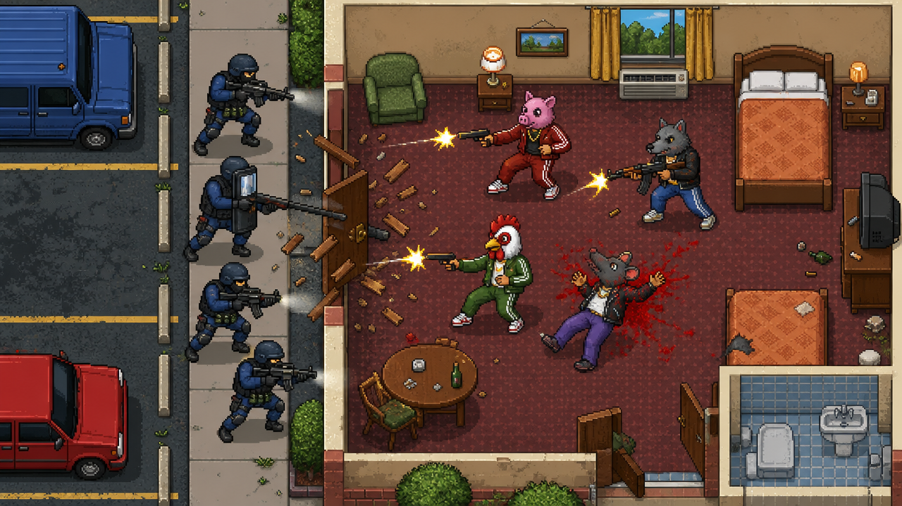

<video src="/img/breachpoint/gameplay.webm" poster="/img/breachpoint/gameplay-poster.webp" autoplay muted loop playsinline aria-label="BREACHPOINT gameplay: a squad breaches and clears a building"></video>

It's a solo project: I designed and directed it, and built it together with Claude Code, from the simulation to the pixel-art painters, the backend, the desktop build, the trailer and the [marketing site](https://www.breachpointhq.com).

---

#### Plan & breach

Every mission is real time with pause. You can plan while paused or play at ×0.5, ×1 or ×2:

- **Routes and go-codes**: draw waypoints, set where each operator looks, and hold them on go-codes A–D for a synchronized entry. Pick a team size at a door and the stack forms itself (split, cross or deep).
- **Door actions for every situation**: open it quietly, kick it, blow it with a breach charge, wedge it shut, pick the lock, slide a mirror under it, or go in with Flash & Clear and Frag & Clear.
- **A simulation that doesn't forgive**: vision cones, noise, cover and suppression decide every fight. Enemies hear you coming, camp doors, take hostages, and sometimes give up.
- **Objectives**: clear the building, rescue hostages, defuse a bomb, grab intel and get out, or arrest a VIP alive.
- **Tools that respect your plan**: a plan timeline with go-code sync, restart keeping your plan, line-of-fire and hit-chance preview, opt-in auto-pause triggers, and fast-forward to contact.

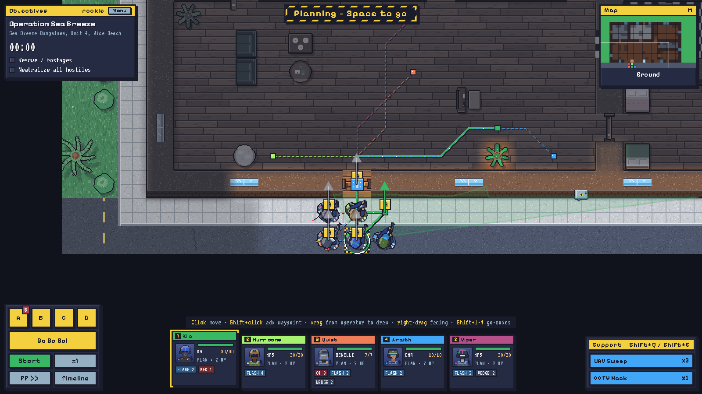

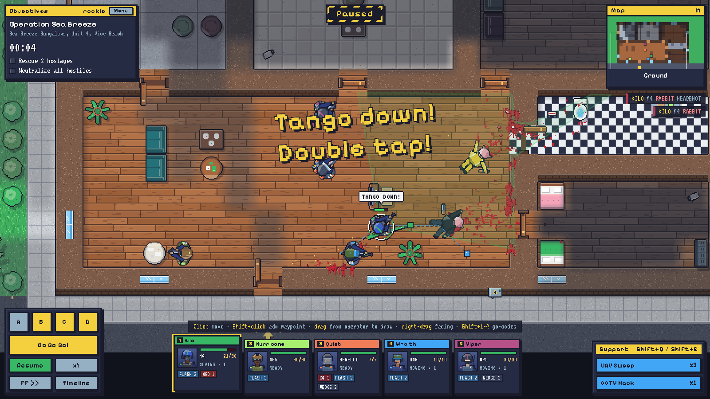

#### Bravo Team vs. the Menagerie

The **Official campaign** is 25 hand-built chapters set in **Port Coralina**, a sun-bleached Gulf Coast city that never got the memo the 80s ended: motels and diners on Vice Beach, a casino on the Boardwalk, biotech labs at the edge of the swamp, and a container terminal on the docks. Bravo Team takes on **the Menagerie**, a syndicate where every animal mask is a job: pig, wolf, rooster, rabbit, horse, owl, tiger, bear.

It plays like an 80s action movie: comic-panel briefings over the real building, five acts, five golden-mask bosses who taunt you on the radio, and an ending on the beach. Beat it on Elite and a secret Episode 26 unlocks.

New players start in **the Killhouse**: twelve tutorial drills with Sgt. "Gunny" Ramos on the radio, trigger zones and medal times, from walking a lane to building your own map.

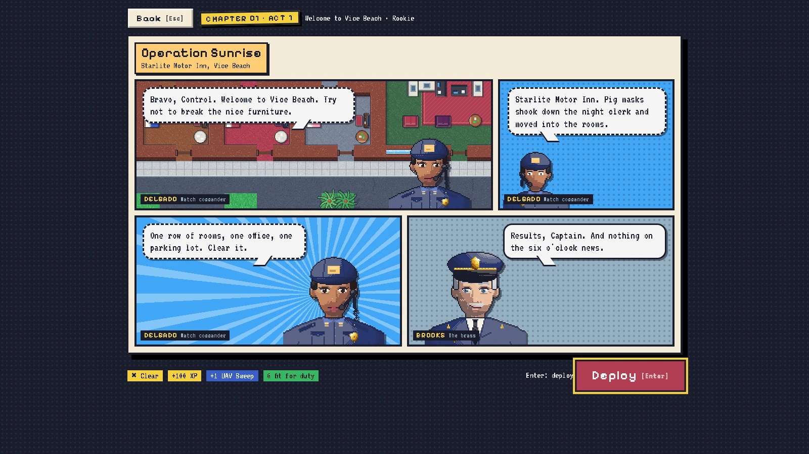

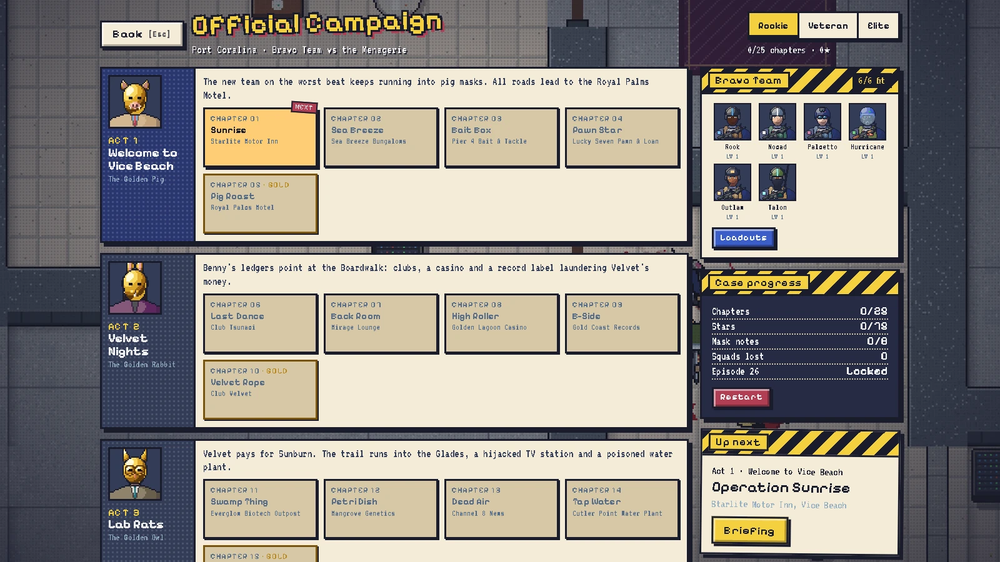

#### Operations: the roguelite

**Operations** is a 25-step run generated from its own seed, so no two players ever see the same buildings. Every step offers 2–3 mission cards, and steps 5, 10, 15, 20 and 25 are boss ops in bigger, multi-storey buildings. There are three difficulties (Rookie, Veteran and Elite), with permadeath on the top two, plus Ironman and New Game+.

On top of that, everyone gets the **same daily mission** and a **five-op weekly operation**, and there are 28 Steam achievements (7 of them secret) with badges on your Service Record.

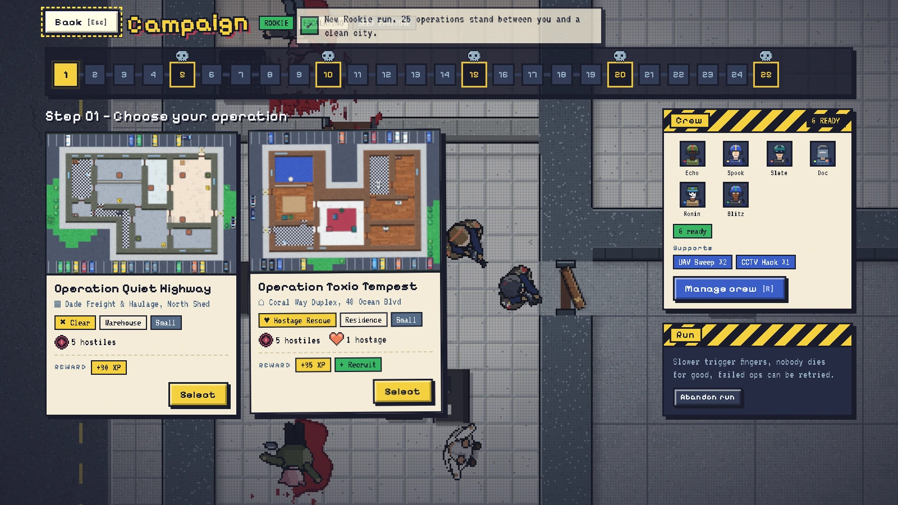

#### Your captain, your HQ, your crew

You have **one captain per account**, with a name, a callsign, a radio voice and a 32px look. Between missions you walk them with WASD around a station house with ten stations: locker, armory, briefing room, range, med bay, memorial wall, map desk, comms, K9 kennel and trophy case. HQ upgrades are bought with merit, and operators killed in action go on the memorial wall.

Your **crew** are named operators in six classes: **Pointman, Assaulter, Breacher, Marksman, Tech and Shield**. Each one is readable at a glance by helmet, kit and weapon, and has a primary and a sidearm (including a non-lethal taser and beanbag), gadgets, perks and quirks earned in the field. Support abilities include a UAV sweep, sniper overwatch, a CCTV hack, helicopter insertion, a K9 that pins thugs for the arrest, and a recon drone that tags every mask it sees through the fog.

The tactics kit goes further: ballistic shields, pepper spray, cutting the power for a night-vision entry, breach charges on thin walls to make your own door, weather and time of day, and civilians who panic.

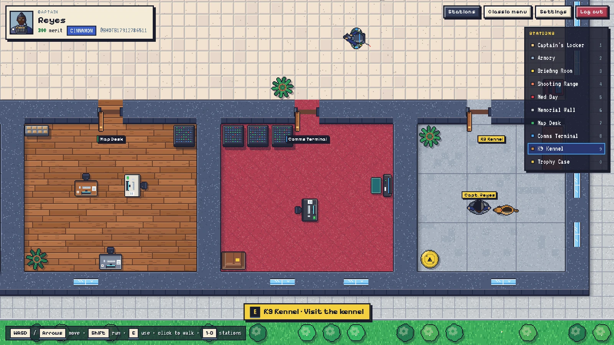

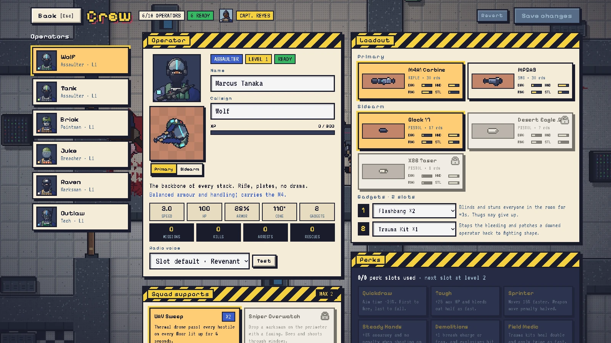

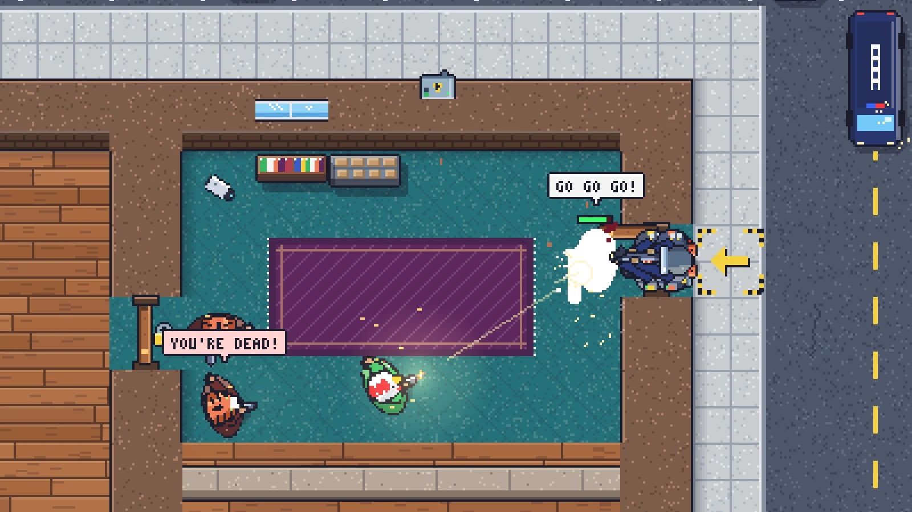

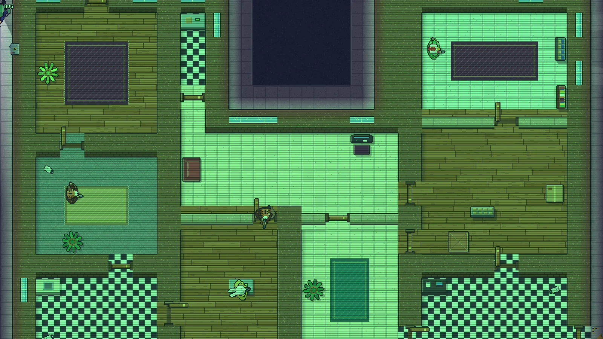

#### Turn-based multiplayer (after launch)

Multiplayer is already built and lands after launch, together with Squad and community maps. It turns the formula into a tactical board game: one side attacks, the other fortifies, and both spend **action points** turn by turn to move, breach, barricade, throw and set overwatch, with sidearms, stun mines and claymores.

- 1v1 or 2v2, **live or async** (turns of up to 24 hours, with a "your turn" email).
- Seasonal ranked with divisions, practice against bots, and bots that fill empty seats.
- Two-player **co-op** on story chapters or generated ops.
- Everything is configurable: best-of 3/5/7/9 or fixed rounds, squad size, AP, turn timer, prep phase, objectives, and procedural or community maps. There's also an Operation mode, a chain of rounds where the dead stay dead and the maps keep growing.

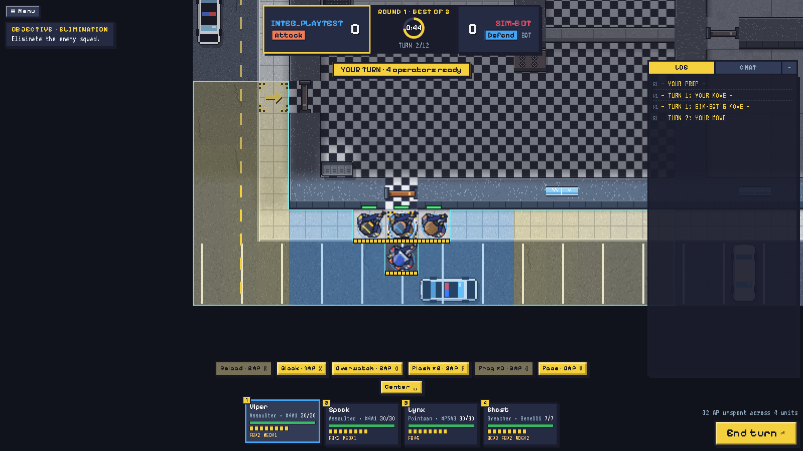

#### Build & share

The **map editor** works Mario Maker style: generate or paint multi-storey buildings with stairs, elevator shafts and skylights to rappel through, roofs, thin walls, entries and authored spawns, with undo, copy and paste, and validation that matches the server.

The twist: **you can only publish a map you have beaten**. Your winning run is replayed on the server and seals that exact version of the map. On Steam you start with your own custom maps and collections; once online play arrives, community maps get ratings, verified leaderboards, Top / Trending / Hardest tabs, creators to follow, collections and remixes.

Every run can also be replayed: scrub through it, follow a single operator, share a link, or export a GIF or video.

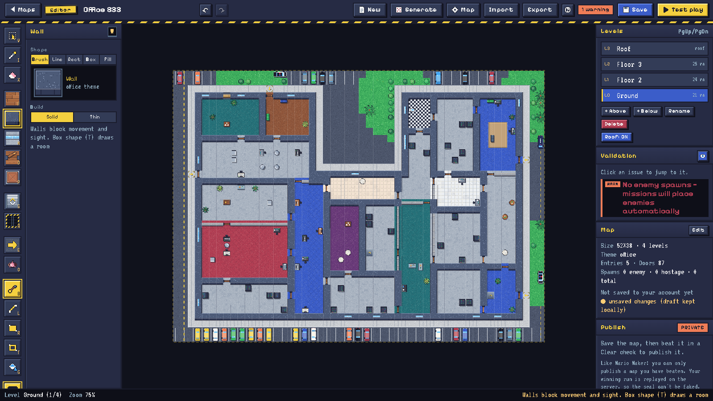

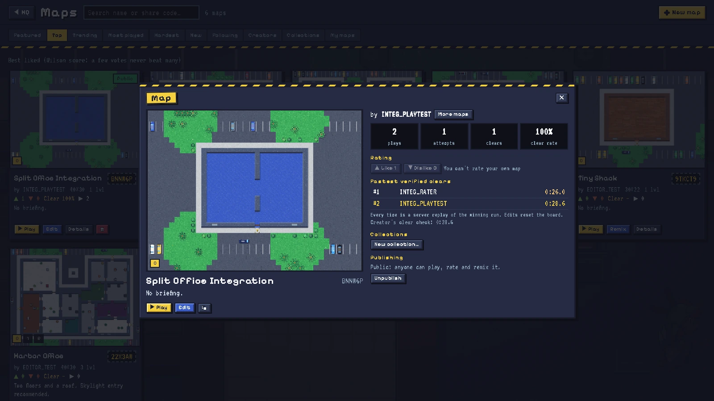

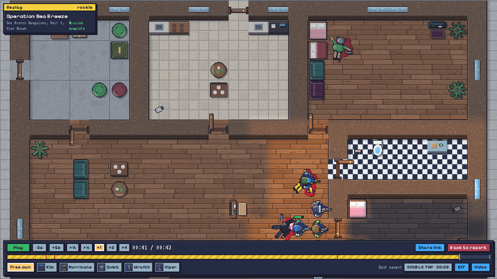

#### Look & sound

The art direction is strict on purpose: **bright daylight, chunky 32px-per-tile pixel art, comic punch and cartoon gore that stays where it lands**. The animal masks are the only thing borrowed from Hotline Miami; there's no neon, no synthwave sunsets. Characters are detailed 32×32 sprites, so you can tell a pointman's ballistic helmet from a marksman's cap, or an M4 from a Benelli.

The brand follows the same rules: the logo is generated from code with a custom 5×7 pixel font, police-tape yellow on SWAT navy, and is only ever scaled by whole numbers.

The sound is an **80s action-movie darksynth soundtrack**, procedural positional sound effects, and voiced barks with a distinct voice per operator ("Tango down!", "Breaching!") over Simlish radio chatter. The voices were generated with ElevenLabs.

It plays with mouse and keyboard (fully remappable) or a gamepad, and has colour-blind palettes, high contrast and UI scale. There's no account to create: you launch it from Steam and play, with your save synced through Steam Cloud. And there are 34 secrets hidden in it.

---

#### How it's built

Everything lives in **one TypeScript repository with six deliverables**: the game client, the desktop app, the backend, the marketing site, the trailer and the docs.

- **A deterministic core.** The heart of the game is `shared/`: pure, deterministic code with no DOM (seeded RNG, BSP building generation, line of sight and vision cones, multi-level A* pathfinding, the real-time simulation and the multiplayer turn rules). The game, the server and the trailer all import it unchanged. That's what makes it possible to replay any run on the server and trust the result, which powers verified map publishing, daily and weekly scores, and leaderboards.
- **Client**: Vite and a hand-written **Canvas 2D renderer**, with the pixel art painted by code and procedural audio.
- **Backend**: [Convex](https://convex.dev) for accounts and passwordless sign-in, cloud saves, multiplayer rooms and matches (with fog of war filtered per seat on the server), community maps, leaderboards and replay verification.
- **Desktop**: the Steam build is an Electron app for Windows and macOS that needs no server and no account. It runs the **same Convex functions in-process** on an in-memory database saved to a single JSON file, so every game rule, validator and replay check is the exact code the online version runs. Steam overlay, achievements and Cloud saves go through steamworks.js, and the depot upload is one script.
- **Content**: the campaign and tutorial maps are ASCII blueprints compiled into the game's map format.
- **Trailer**: an 88-second launch trailer built with [Remotion](https://remotion.dev), cut on the beat to the soundtrack and driven by the real simulation and renderer, so the footage is actual gameplay. There's also a 15-second vertical cut for Shorts, Reels and TikTok.
- **Marketing**: an [Astro site](https://www.breachpointhq.com) with a press kit, store-page copy, Steam capsules, library art, achievement icons and screenshots, all generated from the same assets.

#### Built with a team of agents

BREACHPOINT was built with Claude Code, and the project ships with its own **team of subagents**, each owning an area of the code and its rules: a game designer (weapons, classes and balance), a level designer (campaign maps and map generation), an art director (sprites and the look), a voice director, a sound designer, and a QA validator that has to approve every change before it's committed.

The roadmap was decided the same way: I voted 53 ideas on an idea board (26 must-haves, 24 nice-to-haves, 3 rejected), every one became a GitHub issue, and they were built in waves by parallel agents. Every design decision is logged with an ID in a decisions file, so the reasoning behind each choice stays next to the code.
